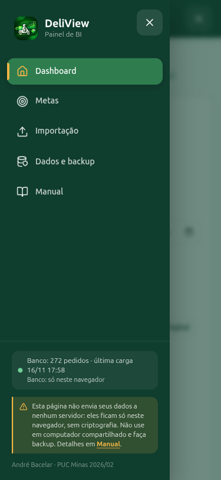
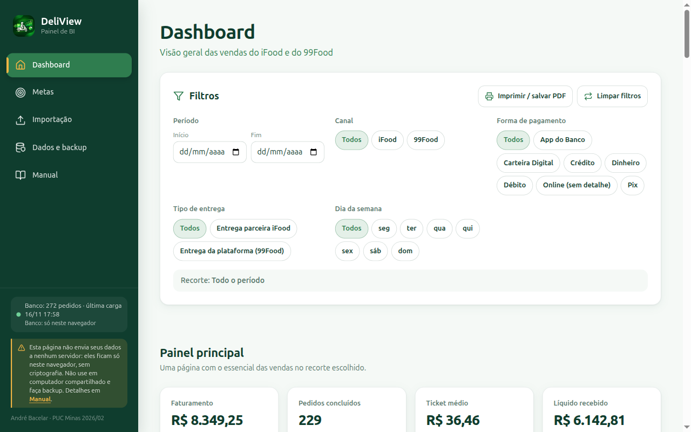
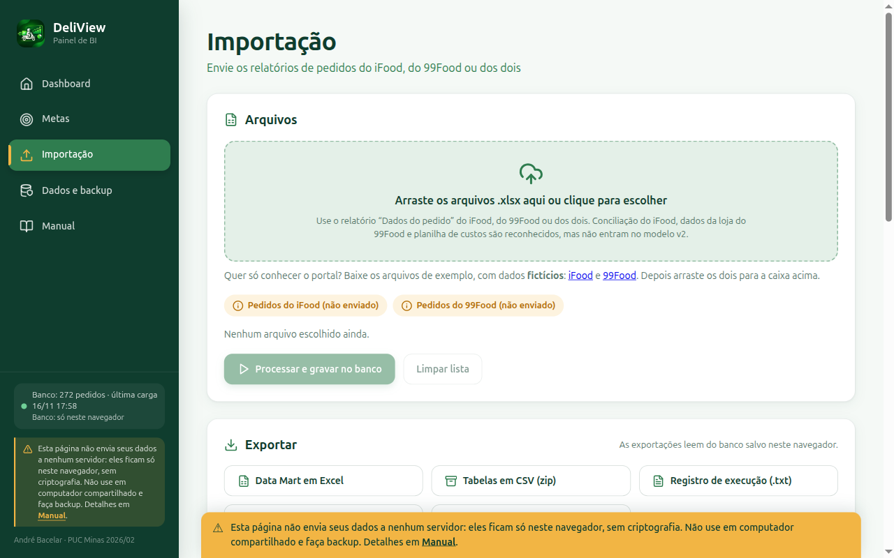
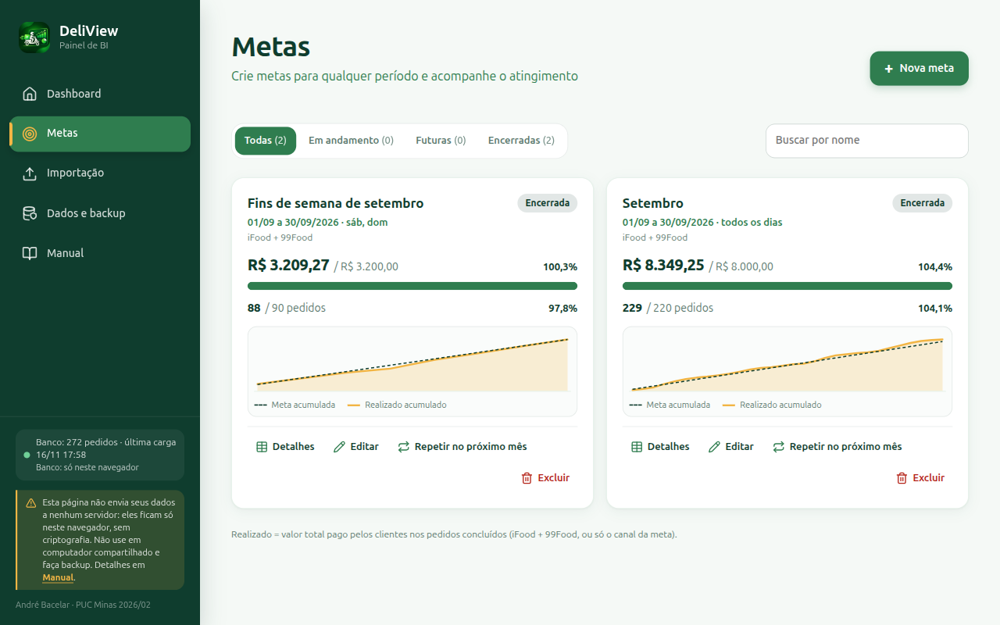
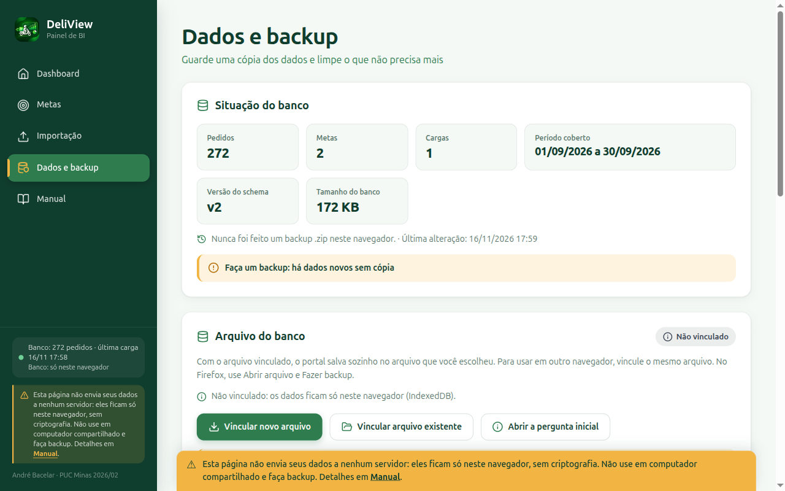
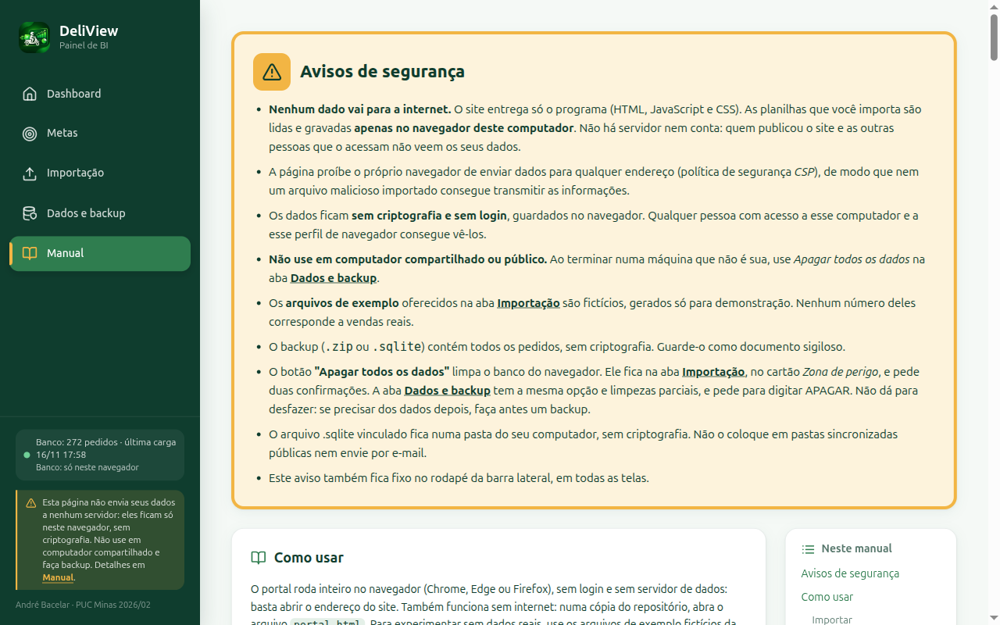
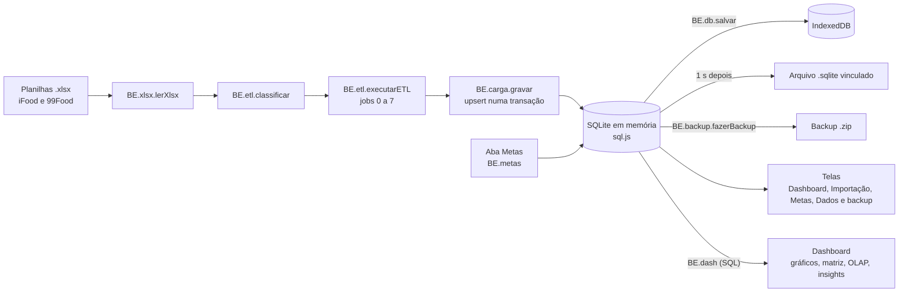
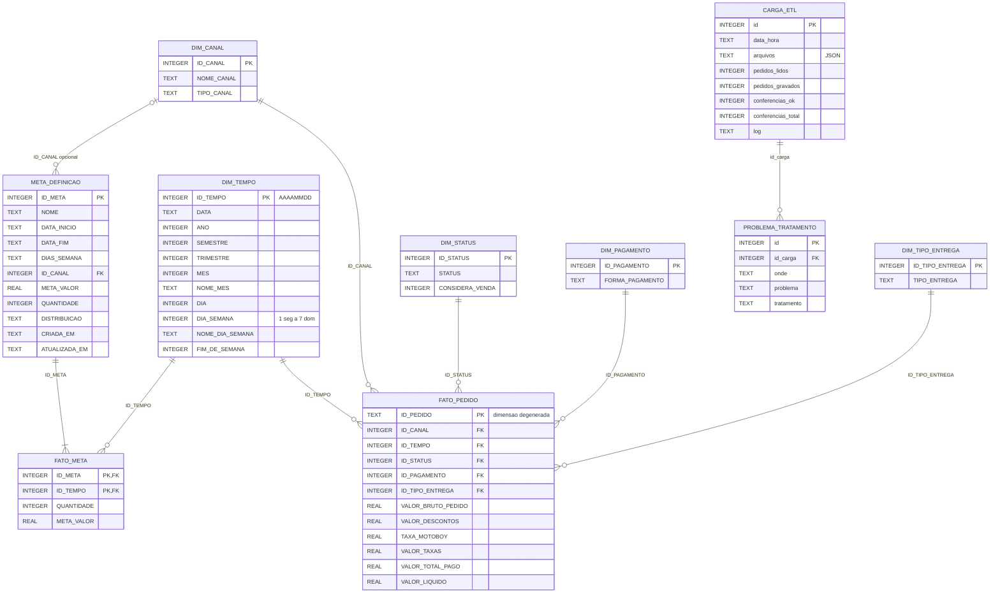

<p align="center"></p>

# DeliView

**DeliView — Dados que entregam resultados.**

Portal de Business Intelligence para o **dono de restaurante** acompanhar as vendas no iFood e no 99Food. Ele importa os relatórios de pedidos das plataformas (de uma ou das duas), grava tudo num banco SQLite dentro do navegador, acompanha metas de faturamento por período e mostra um dashboard com filtros, drill-down, matriz pivot, operações OLAP e insights.

- `index.html`: página de apresentação (a primeira que abre no site publicado).
- `portal.html`: o portal. Também funciona sem internet, abrindo o arquivo direto do disco.

`sem servidor` · `funciona offline` · `HTML/CSS/JS` · `SQLite no navegador`

Para experimentar, use as planilhas **fictícias** de [`exemplos/`](exemplos/). Nenhum número deste repositório é de vendas reais.

## Índice

1. [Resumo](#deliview) (esta abertura)
2. [Segurança e privacidade](#2-segurança-e-privacidade)
3. [Início rápido](#3-início-rápido)
4. [Telas](#4-telas)
5. [Arquitetura](#5-arquitetura)
6. [Tecnologias](#6-tecnologias)
7. [Estrutura de pastas](#7-estrutura-de-pastas)
8. [Modelo de dados](#8-modelo-de-dados)
9. [ETL](#9-etl)
10. [Metas](#10-metas)
11. [Persistência, backup e limpeza](#11-persistência-backup-e-limpeza)
12. [Exportações](#12-exportações)
13. [Testes e verificação](#13-testes-e-verificação)
14. [API interna](#14-api-interna)
15. [Solução de problemas (FAQ)](#15-solução-de-problemas-faq)
16. [Limitações conhecidas](#16-limitações-conhecidas)
17. [Próximos passos (sugestões)](#17-próximos-passos-sugestões)
18. [Convenções do projeto](#18-convenções-do-projeto)
19. [Contexto acadêmico](#19-contexto-acadêmico)
20. [Créditos e licenças](#20-créditos-e-licenças)

## 2. Segurança e privacidade

> **⚠ Esta página não envia seus dados a nenhum servidor: eles ficam só neste navegador, sem criptografia. Não use em computador compartilhado e faça backup.**
>
> Este é o texto de `BE.textos.avisoSeguranca`, o mesmo que aparece fixo no rodapé da barra lateral, na Importação e em Dados e backup.

**Por que o site pode ficar publicado.** O site entrega só o programa. As planilhas importadas são lidas e gravadas no navegador de quem usa (IndexedDB): não há servidor de dados nem login, então ninguém, nem quem publicou o site, vê os dados de outra pessoa. O `portal.html` e o `index.html` trazem uma política de segurança (CSP, na tag `<meta http-equiv="Content-Security-Policy">`) com `connect-src 'none'`: o navegador fica proibido de enviar dados para qualquer endereço, mesmo se um arquivo malicioso for importado. O sql.js vai junto (`vendor/`), sem CDN.

Avisos do Manual:
- Nenhum dado vai para a internet: as planilhas ficam só no navegador do computador onde foram importadas.
- Os dados ficam **sem criptografia e sem login**. Qualquer pessoa com acesso ao computador e ao perfil do navegador consegue vê-los.
- **Não use em computador compartilhado ou público.** Numa máquina que não é sua, termine com *Apagar todos os dados*.
- Os arquivos de exemplo são fictícios, gerados só para demonstração.
- O backup (`.zip` ou `.sqlite`) contém todos os pedidos, sem criptografia. Guarde-o como documento sigiloso.
- O arquivo `.sqlite` vinculado fica numa pasta do computador, sem criptografia. Não o coloque em pastas sincronizadas públicas nem o envie por e-mail.
- "Apagar todos os dados" e "Limpar navegador" não podem ser desfeitos. Faça um backup antes.

**O que fica guardado no banco.** Pedidos (ID do pedido na plataforma, dia, canal, status), valores (bruto, descontos, taxas, motoboy, total pago, líquido) e forma de pagamento padronizada. Também ficam as metas cadastradas e o registro das importações (nomes dos arquivos e log).

**O que não fica guardado.** O ETL (`js/etl/etl.js`, jobs 3 e 4) lê só as colunas listadas em [ETL](#9-etl). Nome, telefone, endereço ou ID de cliente **não entram no banco**.

> **Atenção às planilhas de origem.** Os arquivos `.xlsx` exportados das plataformas trazem mais colunas do que o portal usa, como "ID do cliente que fez o pedido", "Conteúdo de avaliação do cliente" e "Nome do signatário" (99Food) e CNPJ (conciliação do iFood). **Nunca coloque relatórios reais neste repositório.** A pasta `dados-teste/` existe só no computador do desenvolvedor e está no `.gitignore`.

**Onde os dados ficam.**

| Lugar | O que é | Quem tem acesso |
|---|---|---|
| IndexedDB do navegador | Cópia automática, uma por navegador e por perfil | Quem usa aquele perfil |
| Arquivo `.sqlite` vinculado (Chrome/Edge) | Arquivo na pasta que você escolheu, gravado sozinho | Quem acessa a pasta |
| Backups `.zip` e `.sqlite` | Cópias feitas por você | Onde você guardar |

**Ao trocar de computador.** Leve o arquivo vinculado ou o último backup `.zip`. No computador novo, abra o portal: a pergunta inicial oferece **Abrir arquivo do banco** (qualquer navegador) ou **Vincular arquivo do banco** (Chrome/Edge). Depois apague as cópias que ficaram em pen drives ou pastas temporárias.

**Nota sobre a LGPD.** Os dados são da operação da loja e o tratamento é todo local: o portal não envia nada para servidores, não usa CDN e não faz `fetch` de rede. A loja continua responsável pelos dados que exporta das plataformas, inclusive pelas planilhas originais. Esta nota não é um parecer jurídico.

## 3. Início rápido

1. **Abra o portal.** No site publicado, clique em *Abrir o portal*. Numa cópia do repositório, dê dois cliques no `portal.html`: ele abre no navegador via `file://`, sem instalar nada.
2. **Responda à pergunta inicial.** Num navegador sem dados aparece "Onde está o banco de dados?". Para começar do zero, escolha **Começar com banco vazio**.
3. **Importe os arquivos.** Em **Importação**, arraste as 2 planilhas de `exemplos/` (ou os seus relatórios "Dados do pedido" do iFood e do 99Food) para a caixa pontilhada e clique em **Processar e gravar no banco**. Conciliação do iFood, dados da loja do 99Food e planilha de custos são reconhecidos, mas ignorados.
4. **Confira.** Com os exemplos, o quadro mostra **6 de 6 conferências aprovadas**, 272 pedidos e "Vendas por plataforma" com 64 + 165 = 229 concluídos e R$ 8.349,25 pagos pelos clientes. Importando só uma planilha, mostra 5 de 5 (iFood) ou 4 de 4 (99Food).
5. **Faça o backup.** Em **Dados e backup**, clique em **Fazer backup (.zip)**. No Chrome e no Edge, você também pode usar **Vincular novo arquivo**.

### Compatibilidade

**Testado** = rodou em `file://` com o Google Chrome 157 (modo headless, 13/11/2026), pelos testes automáticos e pela navegação nas 5 telas. **Em teoria** = a API existe no navegador, mas o portal não foi testado nele. O relatório de verificação manual (`docs/verificacao.md`) ainda não foi feito.

| Recurso | Chrome | Edge | Firefox |
|---|---|---|---|
| Abrir via `file://` | ✅ Testado | Em teoria | Em teoria |
| IndexedDB | ✅ Testado | Em teoria | Em teoria |
| Arquivo vinculado (File System Access API) | ⚠ API presente em `file://`; o fluxo completo depende do seletor nativo e não foi testado | Em teoria | ❌ Não existe: use Abrir arquivo e backup |
| "Salvar como" do backup | ⚠ API presente; não testado. Se falhar, o portal baixa normalmente | Em teoria | ❌ Download comum, com dica para escolher a pasta |
| `CompressionStream` / `DecompressionStream` | ✅ Testado (importação de .xlsx e backup .zip) | Em teoria | Em teoria |

## 4. Telas

O menu lateral tem 5 itens. Abaixo de 1024px ele vira um drawer, aberto pelo botão ☰.



### Dashboard



- **Para que serve:** responder às perguntas de negócio sobre as vendas do recorte escolhido e documentar as operações OLAP da Etapa 7.
- **Filtros:** período (início e fim), canal, forma de pagamento, tipo de entrega e dia da semana, com chips de seleção múltipla e "Limpar filtros". O recorte fica na URL (`#/dashboard?inicio=…&canal=…`) e no `localStorage` (`be.dash.filtros`), e aparece resumido ("agosto/2026 · iFood · Pix").
- **Painel principal:** 4 KPIs (faturamento, pedidos concluídos, ticket médio, líquido recebido) com variação contra o período anterior de igual duração; faturamento diário por canal (linhas), do bruto ao líquido (cascata), cancelamento por canal (barras), pedidos por dia da semana (mapa de calor) e formas de pagamento (rosca).
- **Análises por tema:** 7 seções recolhíveis (Vendas e faturamento, Rentabilidade por canal, Cancelamentos, Descontos e promoções, Ticket médio, Pagamento e entrega, Metas × realizado), cada gráfico com a pergunta de negócio como subtítulo.
- **Drill-down e roll-up:** os gráficos de tempo têm seletor Dia, Semana e Mês; clicar num ponto desce (Mês → Semana → Dia) e, no dia, abre a lista de pedidos com exportação CSV. Clicar no mapa de calor filtra o dia da semana.
- **Exploração OLAP:** matriz pivot (linhas × colunas × medida, com totais, cores do mapa de calor, "Inverter" e CSV), comparação com drill-down e a tabela "Operações OLAP neste recorte" (slice, dice, drill-down, roll-up e pivot), preenchida a partir do estado atual e copiável em Markdown. Exemplos em [docs/olap.md](docs/olap.md).
- **Insights:** de 3 a 6 cartões Visualização → Insight → Decisão gerados por regras fixas sobre o recorte.
- **Impressão:** "Imprimir / salvar PDF" abre todas as seções, esconde menu e filtros, imprime o recorte e põe no rodapé a data e o aviso de dados sigilosos.
- **Acessibilidade:** gráficos com `role="img"` e resumo, tooltip no mouse e no foco do teclado e botão "Ver dados" com a tabela dos mesmos valores.
- **Banco:** só lê. Toda agregação é feita em SQL (JOIN nas dimensões e GROUP BY), com os filtros passados como parâmetros.

### Importação



- **Para que serve:** levar os relatórios das plataformas para o banco.
- **O que se faz:**
  - arrastar os `.xlsx` e processar (o relatório de pedidos do iFood, o do 99Food ou os dois; cada plataforma pode vir numa importação separada);
  - ver as conferências e a tabela "Vendas por plataforma";
  - exportar o Data Mart;
  - ver o histórico de cargas;
  - conferir qualquer tabela do banco;
  - salvar ou abrir um `.sqlite`;
  - apagar todos os dados.
- **Banco:** grava as dimensões, a `FATO_PEDIDO` (upsert), a `CARGA_ETL` e a `PROBLEMA_TRATAMENTO`. Lê todas as tabelas para as exportações e a prévia.

### Metas



*Prints com os dados fictícios de setembro/2026.*

- **Para que serve:** definir metas de faturamento e de pedidos para qualquer período e acompanhar o atingimento.
- **O que se faz:**
  - criar, editar, excluir e repetir no próximo mês;
  - filtrar por status e buscar por nome;
  - abrir os detalhes: gráfico diário Meta × Realizado e tabela por dia com ajuste manual.
- **Banco:** grava `META_DEFINICAO`, `FATO_META` e, se faltar, o dia em `DIM_TEMPO`. Lê `FATO_PEDIDO`, `DIM_STATUS`, `DIM_TEMPO` e `DIM_CANAL` para o realizado.

### Dados e backup



- **Para que serve:** cuidar da cópia de segurança e da limpeza dos dados.
- **O que se faz:**
  - ver a situação do banco;
  - vincular, reconectar ou desvincular o arquivo `.sqlite`;
  - fazer e restaurar backup com prévia;
  - pedir a proteção do armazenamento;
  - verificar a integridade;
  - usar as 4 limpezas da Zona de perigo.
- **Banco:** lê as contagens. Substitui o banco inteiro na restauração e apaga tabelas nas limpezas.

### Manual



- **Para que serve:** explicar o uso e o motor ETL dentro do próprio portal.
- **O que se faz:** ler os avisos de segurança (sempre no topo), o "Como usar" e o "Sobre" (Documentação Técnica do Motor ETL, adaptada da Etapa 5). O sumário rola até cada seção.
- **Banco:** não lê nem grava.

## 5. Arquitetura



| Decisão | Por quê |
|---|---|
| Scripts clássicos (`<script src>`), sem ES modules | O Chrome bloqueia `type="module"` em `file://` (origem nula). Scripts clássicos carregam do disco sem servidor. |
| Namespace único `window.BE` | Sem módulos, tudo vira global. Um único objeto evita colisões e deixa claro o que é do portal (`BE.db`, `BE.etl`…). A ordem de carga fica no `portal.html`. |
| Rotas por hash (`#/dashboard`, `#/metas`…) | Trocar o hash não recarrega a página nem pede servidor. O botão Voltar do navegador funciona. |
| Gráficos em SVG próprio (`js/graficos.js`) | Bibliotecas de gráfico viriam de CDN ou exigiriam npm. Os 10 tipos do portal (barras, linhas, cascata, rosca, mapa de calor, empilhadas, dispersão, boxplot, progresso e o mini acumulado) cabem num arquivo, e o SVG é nítido em qualquer tela e na impressão. |
| sql.js build **asm** em vez de wasm | O build wasm busca o `.wasm` com `fetch`, que falha em `file://`. O asm traz tudo no próprio `.js` (~1,3 MB) e roda offline. |

## 6. Tecnologias

| Tecnologia | Versão | Uso | Por quê |
|---|---|---|---|
| sql.js | 1.12.0 (build asm) | Banco SQLite em memória (`vendor/sql-asm.js`) | SQL de verdade no navegador, sem servidor |
| IndexedDB | API do navegador | Cópia automática do banco (store `sqlite`) e do vínculo (store `config`) | Persiste entre aberturas e aceita arquivos binários |
| File System Access API | API do navegador (Chrome/Edge) | Arquivo `.sqlite` vinculado e "Salvar como" do backup | Gravar num arquivo escolhido pelo usuário |
| `CompressionStream` / `DecompressionStream` | API do navegador (`deflate-raw`) | Ler `.xlsx` e comprimir o backup `.zip` | Zip sem bibliotecas |
| Web Crypto | `crypto.subtle.digest('SHA-256')` | Conferir o banco dentro do backup | Detectar `.zip` alterado ou corrompido |
| `navigator.storage` | `estimate`, `persist`, `persisted` | Cartão "Proteção do armazenamento" | Pedir que o navegador não apague os dados |
| SVG | Inline | Ícones (`js/icones.js`) e gráficos (`js/graficos.js`) | Sem imagens nem bibliotecas |
| CSS com variáveis | `css/estilo.css` | Paleta (`--floresta`, `--folha`, `--menta`, `--fundo`, `--milho`), bordas e sombras | Um só lugar para a identidade visual |

**Não é usado:** Node, npm, frameworks, CDN, fontes externas, servidor ou `fetch` de rede. O único arquivo de terceiros é `vendor/sql-asm.js`.

## 7. Estrutura de pastas

```text
.
├── index.html                 página de apresentação (raiz do site publicado)
├── portal.html                casca do portal: sidebar, drawer, área das telas, CSP e ordem dos scripts
├── README.md                  este arquivo
├── assets/
│   ├── logo.png               ícone do DeliView (menu e favicon)
│   ├── logo-completo.png      logo com o nome (README)
│   ├── fontes/                Bricolage Grotesque (licença OFL) da apresentação
│   └── telas/                 prints com os dados fictícios usados na apresentação
├── css/
│   ├── estilo.css             todo o visual do portal (paleta, componentes, responsivo)
│   └── apresentacao.css       visual da página de apresentação
├── exemplos/                  2 planilhas fictícias (iFood e 99Food, setembro/2026)
├── ferramentas/
│   └── gerar-exemplos.py      gera de novo as planilhas fictícias (Python, sem bibliotecas)
├── js/
│   ├── iniciar.js             chama BE.iniciar() (a CSP bloqueia script embutido no HTML)
│   ├── app.js                 rotas por hash, menu/drawer, toasts, textos e helpers da casca
│   ├── schema.js              tabelas do SQLite e migrações (v1, v2)
│   ├── db.js                  BE.db: sql.js + IndexedDB, backup .sqlite, limpezas, integridade
│   ├── backup.js              BE.backup: backup .zip com manifesto, leitura e prévia
│   ├── arquivo-banco.js       BE.arquivoBanco: arquivo .sqlite vinculado com gravação automática
│   ├── graficos.js            BE.graficos: gráficos em SVG (barras, linhas, cascata, rosca, mapa de calor…)
│   ├── icones.js              BE.icone: ícones SVG inline
│   ├── componentes/
│   │   ├── banco-inicial.js   pergunta "Onde está o banco?", faixa Reconectar, linha do indicador
│   │   ├── calendario.js      BE.ui.calendario: escolha de período
│   │   └── placeholder.js     BE.ui.placeholder: bloco reservado (título, pergunta, chips)
│   ├── consultas/
│   │   ├── metas.js           BE.metas: regras das metas por período
│   │   ├── dashboard.js       BE.dash: filtros, consultas do painel, das seções e da matriz pivot
│   │   ├── olap.js            BE.dash.operacoesOlap: tabela de operações OLAP do recorte
│   │   └── insights.js        BE.dash.insights: cartões Visualização → Insight → Decisão
│   ├── etl/
│   │   ├── zip-xlsx.js        BE.xlsx: leitura e escrita de .xlsx e .zip (da Etapa 5)
│   │   ├── etl.js             BE.etl: motor ETL, jobs 0 a 7 (da Etapa 5)
│   │   └── carga.js           BE.carga: gravação no banco e exportações
│   └── telas/
│       ├── dashboard.js       filtros, painel principal, seções, drill-down, matriz, OLAP, insights e impressão
│       ├── importacao.js      importação, conferências, exportações, histórico
│       ├── metas.js           cartões de metas, painel de edição e detalhe diário
│       ├── dados.js           situação, arquivo vinculado, backup, limpezas, integridade
│       └── manual.js          segurança, como usar e documentação do ETL
├── vendor/
│   ├── sql-asm.js             sql.js 1.12.0, build asm
│   ├── LICENSE                licença MIT do sql.js
│   └── LEIAME.md              origem, SHA-256 e motivo do build asm
├── referencia/                SOMENTE LEITURA
│   ├── etl-etapa5.html        HTML do ETL da Etapa 5 (fonte do código extraído)
│   └── ModelagemDimensional_Etapa05_v2.drawio  diagrama do modelo dimensional v2
└── docs/
    ├── modelo-de-dados.md     colunas de cada tabela, origem e migrações
    ├── api-interna.md         funções públicas de cada módulo BE.*
    ├── olap.md                exemplos das 5 operações OLAP com os dados fictícios
    └── img/                   prints das telas (1280px), do drawer (375px) e das operações OLAP, com os dados fictícios
```

Ficam só no computador do desenvolvedor (no `.gitignore`): `dados-teste/`, com os relatórios reais usados no desenvolvimento, e `tests/`, cujos testes de ETL, metas e dashboard conferem os números desses relatórios.

## 8. Modelo de dados

São duas estrelas que compartilham `DIM_TEMPO` e `DIM_CANAL`, mais duas tabelas de controle. As colunas de cada tabela, com tipo e origem, estão em [docs/modelo-de-dados.md](docs/modelo-de-dados.md).



| Fato | Grão | Observação |
|---|---|---|
| `FATO_PEDIDO` | 1 pedido | `ID_PEDIDO` é a chave primária e a **dimensão degenerada**: identifica o pedido sem uma dimensão própria. |
| `FATO_META` | 1 dia elegível de 1 meta | Chave (`ID_META`, `ID_TEMPO`). Metas que se sobrepõem convivem, cada uma com o seu `ID_META`. |

- **ZERA FATOS.** Em pedido cancelado, só `VALOR_BRUTO_PEDIDO` é mantido, para medir a demanda perdida. Descontos, motoboy, taxas, total pago e líquido ficam em 0. A conferência (b3) do JOB 7 verifica isso.
- **Versão e migrações.** A versão fica em `PRAGMA user_version`. A v1 é o modelo da Etapa 5. A v2 cria a `META_DEFINICAO`, troca a chave da `FATO_META` e converte as metas antigas, uma definição por mês. Backups antigos migram ao serem restaurados. Um banco de versão mais nova que o portal é recusado.
- **Relação com o diagrama** (`referencia/ModelagemDimensional_Etapa05_v2.drawio`):
  - tabelas e colunas das duas estrelas têm os mesmos nomes do diagrama;
  - o diagrama traz `NOME_DIA_SEMNA`, e o código usa `NOME_DIA_SEMANA` (erro de grafia corrigido no ETL);
  - **acrescentado:** `META_DEFINICAO`, a chave composta da `FATO_META` e as tabelas de controle `CARGA_ETL` e `PROBLEMA_TRATAMENTO`;
  - a nota do diagrama ainda cita uma `FATO_LANCAMENTO`, que não existe como tabela nem no diagrama nem no banco.

## 9. ETL

O motor foi extraído da Etapa 5 (`referencia/etl-etapa5.html`) sem mudar as regras. Os nomes abaixo são os registrados no log de execução.

| Job | Entrada | Transformação | Saída |
|---|---|---|---|
| JOB 0 - EXTRACAO | Linhas dos relatórios "Dados do pedido" | Deduplica pelo ID do pedido, mantendo a 1ª ocorrência | Listas de pedidos únicos |
| JOB 1 - DIM_TEMPO | Datas dos pedidos | Calendário diário de 01/01 do menor ano a 31/12 do maior | `DIM_TEMPO` |
| JOB 2 - DIM_CANAL, DIM_STATUS, DIM_PAGAMENTO, DIM_TIPO_ENTREGA | Formas de pagamento dos dois canais | Canais, status e entregas fixos; formas padronizadas e numeradas em ordem alfabética | 4 dimensões |
| JOB 3 - TRANSFORMACAO iFood (pedidos) | Pedidos do iFood | Medidas padronizadas + ZERA FATOS | Pedidos iFood |
| JOB 4 - TRANSFORMACAO 99Food (pedidos) | Pedidos do 99Food | Medidas padronizadas + ZERA FATOS | Pedidos 99Food |
| JOB 5 - CARGA DA FATO_PEDIDO | Saídas dos jobs 2 a 4 | Junta os canais e troca textos por chaves (FK) | `FATO_PEDIDO` |
| JOB 6 - FATO_META | (sem fonte) | Cria a estrutura vazia: as plataformas não exportam metas | `FATO_META` vazia |
| JOB 7 - VALIDACAO DA CARGA | Fato e dimensões | 3 conferências contábeis + 3 de integridade | `VALIDACAO_DA_CARGA`, problemas |

Depois do ETL, `BE.carga.gravar` faz o upsert no SQLite numa transação única e registra a carga.

### Arquivos de entrada

| Arquivo típico | Como `classificar` reconhece | Uso | Colunas usadas |
|---|---|---|---|
| `Dados do pedido - Agosto - iFood.xlsx` | 1ª aba com `ID COMPLETO DO PEDIDO` e `VALOR LIQUIDO (R$)` | **Pedidos iFood** | `ID COMPLETO DO PEDIDO`, `DATA E HORA DO PEDIDO`, `STATUS FINAL DO PEDIDO`, `FORMA DE PAGAMENTO`, `VALOR DOS ITENS (R$)`, `INCENTIVO PROMOCIONAL DA LOJA / DA REDE / DO IFOOD (R$)`, `TAXAS E COMISSOES (R$)`, `TOTAL PAGO PELO CLIENTE (R$)`, `VALOR LIQUIDO (R$)`; para conferência: `TAXA DE ENTREGA PAGA PELO CLIENTE (R$)`, `TAXA DE SERVIÇO (R$)` |
| `_Dados do pedido(01-08-2026_31-08-2026).xlsx` | 1ª aba com `ID do pedido` e `Horário do cancelamento` | **Pedidos 99Food** | `ID do pedido`, `Data`, `Horário do cancelamento`, `Forma de pagamento`, `Preço original do item`, `Despesas de marketing`, `Custos logísticos`, `Despesas de comissão`, `Taxas de processamento de pagamento`, `Receita de vendas`, `Receita real da loja` |
| `Dados de Conciliação - Agosto - iFood.xlsx` | `pedido_associado_ifood` e `tipo_lancamento` | Ignorado (não há `FATO_LANCAMENTO` no v2) | — |
| `_Dados da loja(…).xlsx` | `Total de vendas realizadas` e `Receita total de vendas` | Ignorado (não há fato de loja) | — |
| `DeliView_ControleDeCustos.xlsx` | Abas `Cardápio` + `Bebidas`, ou `Ingredientes` + `CUSTOS_BI` | Ignorado (`DIM_PRODUTO` saiu do v2) | — |

Arquivo que não é `.xlsx`, ou que não se encaixa em nenhuma regra, aparece como "não reconhecido".

### Regras de negócio

| Medida | iFood | 99Food |
|---|---|---|
| `VALOR_BRUTO_PEDIDO` | `VALOR DOS ITENS (R$)` | `Preço original do item` |
| `VALOR_DESCONTOS` | incentivo da loja + da rede + do iFood | `Despesas de marketing` |
| `TAXA_MOTOBOY` | 0 (entrega parceira) | `Custos logísticos` |
| `VALOR_TAXAS` | \|`TAXAS E COMISSOES (R$)`\| | `Despesas de comissão` + `Taxas de processamento de pagamento` |
| `VALOR_TOTAL_PAGO` | `TOTAL PAGO PELO CLIENTE (R$)` | `Receita de vendas` |
| `VALOR_LIQUIDO` | `VALOR LIQUIDO (R$)` | `Receita real da loja` |
| Status | `STATUS FINAL DO PEDIDO` | CANCELADO se `Horário do cancelamento` estiver preenchido |

- **Formas de pagamento** (`BE.etl.formaPagamento`, primeira regra que casar):
  - contém "dinheiro" → Dinheiro;
  - "pix" → Pix;
  - "carteira digital" → Carteira Digital;
  - "app do banco" → App do Banco;
  - "crédito" → Crédito;
  - "débito" → Débito;
  - exatamente "pagamento online" → Online (sem detalhe);
  - qualquer outro texto → Outros, registrado como problema.
- **Deduplicação:** o JOB 0 mantém a 1ª ocorrência de cada ID e registra o alerta.
- **Upsert por `ID_PEDIDO`:** `BE.carga.gravar` usa `INSERT … ON CONFLICT(ID_PEDIDO) DO UPDATE`. O mesmo pedido é substituído e meses novos se acumulam. As dimensões são casadas pelo nome, para que uma forma de pagamento nova numa carga posterior não troque os IDs antigos.
- **Conferência que falha:** o portal pergunta "N conferências falharam. Gravar mesmo assim?" antes de gravar.

### Conferências automáticas (JOB 7)

| # | Conferência | O que verifica |
|---|---|---|
| a1 | iFood: liquido = itens (bruto) - desconto loja - taxas | Em cada concluído, bruto − desconto da loja − taxas = líquido (tolerância de R$ 0,011) |
| a2 | iFood: pago cliente = itens + entrega + servico - descontos totais | Bruto + entrega + serviço − descontos = total pago |
| a3 | 99Food: liquido = receita de vendas - taxas e comissoes - custos logísticos | Total pago − taxas − motoboy = líquido |
| b1 | FATO_PEDIDO: ID_PEDIDO unico (PK) | Nenhum ID repetido |
| b2 | FATO_PEDIDO: toda FK existe na dimensao | Canal, tempo, status, pagamento e entrega existem |
| b3 | FATO_PEDIDO: cancelados com medidas zeradas (exceto valor bruto) | Regra ZERA FATOS aplicada |

## 10. Metas

As regras ficam em `js/consultas/metas.js` (`BE.metas`).

- **Dias elegíveis:**
  - são os dias entre o início e o fim cujo dia da semana está marcado (1 = seg … 7 = dom);
  - o período tem no máximo 366 dias e precisa ter ao menos um dia elegível;
  - é preciso informar valor (R$) ou pedidos, pelo menos um maior que zero.
- **Distribuição igual:** o total é dividido igualmente pelos dias elegíveis.
- **Distribuição proporcional:**
  - o peso de cada dia da semana é a média histórica dos pedidos concluídos naquele dia da semana (filtrada pelo canal da meta);
  - a média é o total do dia da semana ÷ quantas vezes ele ocorreu entre o 1º e o último dia com vendas;
  - sem histórico, a meta cai para "igual".
- **Resíduo dos centavos:** `repartir` trabalha com inteiros (centavos ou pedidos):
  - cada dia recebe a parte arredondada sobre o acumulado;
  - o último dia recebe o resíduo, então a soma bate exatamente com o total.
- **Realizado:**
  - soma de `VALOR_TOTAL_PAGO` e contagem dos pedidos com status CONCLUIDO, só nos dias elegíveis;
  - filtra pelo canal, se a meta tiver um;
  - o atingimento é realizado ÷ meta.
- **Status** (pela data local de hoje):

  | Status | Condição |
  |---|---|
  | Futura | `DATA_INICIO` > hoje |
  | Encerrada | `DATA_FIM` < hoje |
  | Em andamento | demais casos |

- **Ritmo necessário** (só em andamento):
  - falta = meta − realizado, nunca negativo;
  - ritmo = falta ÷ dias elegíveis restantes, contando hoje;
  - para pedidos, o ritmo é arredondado para cima.
- **Barra de atingimento:** verde a partir de 100%, amarela de 70% a 99% e vermelha abaixo de 70%.
- **Ajuste manual de um dia:** o total da meta passa a ser a soma dos dias. Editar a meta e salvar redistribui e desfaz os ajustes.
- **Repetir no próximo mês** (`duplicar(id, 'proximo-mes')`):
  - mês inteiro vira o mês seguinte inteiro;
  - outro período anda um mês, com o dia limitado ao fim do mês (31/01 → 28/02);
  - o nome troca o mês ("Agosto" → "Setembro") ou ganha "(setembro/2026)";
  - a API também aceita `'proxima-semana'`, mas a tela usa só o próximo mês.

## 11. Persistência, backup e limpeza

| Forma | Quando usar | Automático? | Como restaurar |
|---|---|---|---|
| Cópia do navegador (IndexedDB) | Sempre; é o banco de trabalho | Sim, a cada importação ou mudança de meta | Abre sozinha no mesmo navegador e perfil |
| Arquivo vinculado `.sqlite` (Chrome/Edge) | Usar os mesmos dados em outro navegador ou perfil; ter um arquivo sempre atual | Sim, 1 s depois de cada gravação, enquanto houver permissão | **Vincular arquivo existente** ou **Abrir arquivo do banco** |
| Backup `.zip` | Foto de um momento; proteção contra apagar por engano | Não; o portal lembra após 7 dias com dados novos | **Restaurar backup** (com prévia) ou pergunta inicial |
| `.sqlite` solto | Compatibilidade com a Importação (Salvar/Abrir banco) | Não | **Abrir banco (.sqlite)** ou **Restaurar backup** |

**Conteúdo do `.zip`** (`deliview-backup-AAAA-MM-DD_HHhMM.zip`, comprimido com deflate):

| Arquivo | Conteúdo |
|---|---|
| `deliview.sqlite` | Banco completo |
| `manifesto.json` | `app`, `versao_schema`, `criado_em` (ISO local), `tabelas` (linhas por tabela) e `sha256_sqlite` |
| `LEIA-ME.txt` | Como restaurar e aviso de dados sigilosos |

Na restauração, o portal confere o SHA-256. Se não bater, recusa com "Backup corrompido".

**As 4 limpezas** (Zona de perigo de Dados e backup). Todas oferecem "Fazer backup antes" e pedem para digitar APAGAR.

| Limpeza | Apaga | Mantém |
|---|---|---|
| Limpar dados de vendas | `PROBLEMA_TRATAMENTO`, `CARGA_ETL`, `FATO_PEDIDO` | Dimensões e metas (o realizado vai a R$ 0,00) |
| Limpar metas | `FATO_META`, `META_DEFINICAO` | Pedidos, cargas e dimensões |
| Limpar banco de dados | As 10 tabelas | Estrutura, versão e data do último backup |
| Limpar navegador (apagar tudo) | O IndexedDB do portal (banco e vínculo) e as chaves `be.*` do `localStorage` | Nada; um banco vazio é criado. O arquivo vinculado no disco não é tocado. |

- **Manter dados neste navegador:** chama `navigator.storage.persist()`, que pede ao navegador que não apague os dados do portal quando o disco enche. Mostra o uso e a cota. Não substitui o backup.
- **Verificar integridade:** roda `PRAGMA integrity_check` e `PRAGMA foreign_key_check` e mostra "Banco íntegro." ou a lista de problemas.

## 12. Exportações

As exportações da Importação leem **do banco** (`BE.carga.tabelasDoBanco`), não da última execução em memória.

| Exportação | Arquivo | Contém | De onde lê |
|---|---|---|---|
| Data Mart em Excel | `DataMart_DeliView_Dimensionado.xlsx` | Uma aba por tabela: `DIM_TEMPO`, `DIM_CANAL`, `DIM_STATUS`, `DIM_PAGAMENTO`, `DIM_TIPO_ENTREGA`, `FATO_PEDIDO`, `FATO_META`, `PROBLEMAS_E_TRATAMENTOS`, `VALIDACAO_DA_CARGA` | Tabelas do banco; problemas e conferências da **última** carga |
| Tabelas em CSV (zip) | `DataMart_DeliView_csv.zip` | As mesmas tabelas, um `.csv` cada (`;`, vírgula decimal, BOM UTF-8) | Idem |
| Registro de execução | `log_execucao.txt` | Log da última carga | `CARGA_ETL.log` |
| Banco `.sqlite` | `deliview-AAAA-MM-DD.sqlite` | Banco inteiro | `BE.db.exportar()` |
| Backup `.zip` | `deliview-backup-AAAA-MM-DD_HHhMM.zip` | Banco + manifesto + LEIA-ME | `BE.backup.gerarZip()` |

## 13. Testes e verificação

Os testes automáticos (`tests/testes.html`, com o mini-runner próprio) rodam no navegador e cobrem banco, ETL, metas, calendário, backup, arquivo vinculado e dashboard. Uma parte deles confere os números dos relatórios reais da loja usados no desenvolvimento. Por isso a pasta `tests/` e os relatórios ficam **fora deste repositório público** (estão no `.gitignore`).

Na versão publicada, a conferência é feita com as planilhas fictícias de `exemplos/`:

| Medida | iFood | 99Food | Total |
|---|---|---|---|
| Pedidos | 80 | 192 | 272 |
| Concluídos | 64 | 165 | 229 |
| Cancelados | 16 (20,0%) | 27 (14,1%) | 43 (15,8%) |
| Total pago pelos clientes (concluídos) | R$ 2.675,57 | R$ 5.673,68 | **R$ 8.349,25** |
| Líquido | R$ 1.875,75 | R$ 4.267,06 | **R$ 6.142,81** |
| Conferências | 5 de 5 (só iFood) | 4 de 4 (só 99Food) | 6 de 6 |

No Dashboard, sem filtros: ticket médio de **R$ 36,46**. Mais exemplos em [docs/olap.md](docs/olap.md).

Antes de publicar, rode `./verificar.sh`: ele confere que nenhum dado real, nome de cliente ou endereço externo entrou nos arquivos versionados.

## 14. API interna

Tudo fica em `window.BE`. A tabela completa, com a assinatura e uma linha por função, está em [docs/api-interna.md](docs/api-interna.md).

| Módulo | Principais funções |
|---|---|
| `BE.db` | `abrir`, `consultar`, `executar`, `transacao`, `salvar`, `exportar`, `restaurarBackup`, `limparVendas`, `limparMetas`, `limparBanco`, `apagarTudo`, `integridade`, `resumo`, `config`, `aoSalvar` |
| `BE.etl` | `lerArquivos`, `classificar`, `executar`, `executarETL`, `tabelaVendas`, `formaPagamento` |
| `BE.xlsx` | `lerXlsx`, `comoObjetos`, `lerZip`, `inflar`, `deflar`, `criarZip`, `criarXlsx` |
| `BE.carga` | `gravar`, `tabelasDoBanco`, `exportarXlsx`, `exportarCsvZip`, `exportarLog`, `baixar` |
| `BE.metas` | `criar`, `atualizar`, `excluir`, `duplicar`, `ajustarDia`, `listar`, `obter`, `detalhe`, `diasElegiveis`, `repartir` |
| `BE.backup` | `fazerBackup`, `gerarZip`, `lerArquivo`, `previa`, `situacao`, `precisaBackup` |
| `BE.arquivoBanco` | `disponivel`, `estado`, `iniciar`, `vincularNovo`, `vincularExistente`, `reconectar`, `desvincular`, `decidirOrigem`, `precisaPerguntaInicial` |
| `BE.graficos` | `barras`, `acumulado`, `linhas`, `cascata`, `rosca`, `mapaCalor`, `barrasEmpilhadas`, `dispersao`, `boxplot`, `progresso`, `redesenhar` |
| `BE.dash` | `filtrosPadrao`, `opcoesFiltros`, `whereFiltros`, `kpis`, `serieTempo`, `pedidosDoDia`, `matriz`, `operacoesOlap`, `olapMarkdown`, `insights` e as consultas de cada gráfico |
| `BE.ui` | `calendario`, `placeholder` |
| `BE.textos` | `avisoSeguranca` |

## 15. Solução de problemas (FAQ)

**Abri em outro navegador e está vazio.**
Cada navegador e cada perfil tem a sua cópia. Na pergunta inicial, use **Abrir arquivo do banco** com o arquivo vinculado ou com um backup `.zip`. No Chrome ou no Edge, use **Vincular arquivo do banco** para continuar gravando no mesmo arquivo.

**Limpei o histórico e perdi os dados.**
"Cookies e dados de sites" apaga o IndexedDB e o vínculo. O arquivo vinculado continua na pasta: vincule-o de novo ou abra-o. Sem arquivo, restaure o último `.zip` em Dados e backup. Sem backup, importe as planilhas de novo e recadastre as metas.

**O botão de vincular não aparece.**
O navegador não tem a File System Access API (Firefox, por exemplo), ou ela foi bloqueada nesta página. O cartão "Arquivo do banco" mostra "Não suportado neste navegador" e o motivo. Use Abrir arquivo e Fazer backup.

**A faixa Reconectar não some.**
O navegador esquece a permissão ao ser fechado. Clique em **Reconectar** e aceite. Se a faixa voltar:
- o arquivo pode ter sido movido, renomeado ou apagado;
- a permissão pode ter sido negada.

Em Dados e backup, use **Desvincular** e depois **Vincular arquivo existente**.

**Importei só uma plataforma.**
É permitido: os pedidos das duas se somam no banco, mesmo em importações separadas. As conferências contábeis da plataforma ausente aparecem como "não se aplica" e não entram na conta de aprovadas. Se o banco não tiver pedidos dela no mesmo período, a Importação mostra um aviso amarelo, e o Dashboard e as Metas avisam nos meses que só têm uma plataforma. O aviso some quando o relatório que falta é importado.

**Conferência falhou na importação.**
O portal pergunta antes de gravar. Veja na tabela "Conferências" qual falhou e confira se os arquivos são do mesmo período e estão completos. Uma forma de pagamento desconhecida vira "Outros" e aparece nos problemas; ela precisa ser incluída em `formaPagamento()`.

**Arquivo não reconhecido.**
Só `.xlsx` é aceito. O portal reconhece o arquivo pelos cabeçalhos da 1ª aba (veja [ETL](#9-etl)). Exporte de novo o relatório "Dados do pedido" sem editar os cabeçalhos.

**Backup corrompido.**
O `.zip` foi alterado ou danificado: o SHA-256 do banco não bate com o manifesto, ou falta `deliview.sqlite`/`manifesto.json`. Use outra cópia. Um `.sqlite` solto é aceito, mas sem essa conferência.

**Modo anônimo.**
O IndexedDB pode não funcionar ou ser apagado ao fechar a janela. O rodapé mostra "(não salvo neste navegador)". Faça um backup antes de sair.

## 16. Limitações conhecidas

- **Grão diário:** não há hora do pedido no modelo, nem turno nem mapa de calor por hora.
- **Sem produtos e itens:** o modelo v2 não tem `DIM_PRODUTO` nem itens por pedido.
- **Sem login e sem criptografia:** quem acessa o perfil do navegador ou os arquivos vê os dados.
- **Sem multiusuário simultâneo:**
  - cada aba carrega o banco inteiro na memória e grava o banco inteiro;
  - com duas abas ou dois navegadores no mesmo arquivo vinculado, vale a última gravação.
- **Firefox:** não oferece arquivo vinculado nem "Salvar como"; só abrir arquivo e download.
- **Dashboard sem hora:** o drill-down para no dia e na lista de pedidos; não há turno nem hora, porque o modelo é diário.
- **Insights:** são regras fixas com limites fixos (60%, 15%, 10 pontos, 1,5 ×). Não há aprendizado nem previsão; com poucos pedidos, um cartão pode refletir só o acaso.
- **Matriz pivot:** uma dimensão por eixo (sem hierarquias aninhadas, como canal › pagamento nas linhas).
- **Impressão:** os gráficos são impressos na largura em que foram desenhados na tela; o resultado varia um pouco entre Chrome e Firefox.
- **Arquivo vinculado:** em geral exige um clique em "Reconectar" a cada abertura do navegador. A comparação entre arquivo e navegador usa a data de modificação, com tolerância de 2 s.
- **Pergunta inicial:** "Limpar navegador" também apaga a escolha "Começar com banco vazio", então a pergunta volta.
- **Exportações:** `PROBLEMAS_E_TRATAMENTOS` e `VALIDACAO_DA_CARGA` refletem só a última carga. `META_DEFINICAO` e `CARGA_ETL` não entram no Excel nem no CSV (estão no `.sqlite` e no `.zip`).
- **Pagamento no 99Food:** o relatório só diz "Pagamento online" ou "em dinheiro", então não dá para separar Pix de cartão nesse canal.
- **Testes de navegador:** os testes automáticos e o fluxo do Dashboard (filtros, drill-down, matriz, OLAP, insights, impressão, 375px e 1280px) foram conferidos no Chromium via `file://`. No Firefox só foi conferido que a página de testes carrega e inicia os testes; o fluxo completo no Firefox ainda precisa de verificação manual.
- **Diagrama de referência:** ainda traz `NOME_DIA_SEMNA` e uma nota sobre `FATO_LANCAMENTO`, que não existe mais.

## 17. Próximos passos (sugestões)

Prioridade: alta, média ou baixa. Esforço: P (pequeno), M (médio) ou G (grande).

| Sugestão | Valor | Prioridade | Esforço |
|---|---|---|---|
| Limites dos insights editáveis pelo dono (ex.: cancelamento acima de 10% em vez de 15%) | Ajusta os alertas à realidade da loja | Média | P |
| Comparação lado a lado de dois recortes (ex.: julho × agosto, iFood × 99Food) | Hoje a comparação é contra o período anterior; um segundo recorte livre amplia a análise | Média | M |
| Matriz com dimensões aninhadas nas linhas (ex.: canal › forma de pagamento) | Permite drill-down dentro da própria matriz | Baixa | M |
| Salvar recortes favoritos com nome | Volta a uma análise frequente com um clique | Baixa | P |
| Backup protegido por senha (AES-GCM via Web Crypto), com o aviso de que esquecer a senha perde os dados | Reduz o risco de vazar o `.zip` | Média | M |
| Acessibilidade: auditoria com leitor de tela, modo alto contraste e tema escuro | Já há foco visível e ARIA; falta validar com uso real | Média | M |
| Testes automatizados com Playwright, só para quem desenvolve, sem afetar o produto | Repete a verificação manual ponta a ponta a cada mudança | Média | P |
| Calendário de feriados e datas comemorativas na `DIM_TEMPO` | Explica picos e vales de venda | Baixa | M |
| Hora do pedido, se o modelo for revisado: mapa de calor dia × hora | Os relatórios já trazem a hora; hoje o modelo descarta | Baixa | M |
| Itens e produtos, se o modelo voltar a ter `FATO_ITEM_PEDIDO`: curva ABC e engenharia de cardápio | Depende de uma fonte com itens por pedido, que as exportações atuais não trazem | Baixa | G |
| PWA instalável | Só funciona com servidor local: o service worker não roda em `file://`. Contraria o "abrir do disco" | Baixa | M |

## 18. Convenções do projeto

- **Sem servidor:** só HTML, CSS e JavaScript puro, publicado como site estático ou aberto via `file://`. Sem Node ou npm no produto, frameworks, CDN, fontes externas ou `fetch` de rede. A única biblioteca é o `vendor/sql-asm.js`.
- **Scripts clássicos** e namespace `window.BE`; nada de `type="module"`.
- **pt-BR** na interface e no código; moeda com `Intl.NumberFormat('pt-BR')`.
- **Paleta:** floresta `#0f3d2e`, folha `#2f7d4f`, menta `#e4f0e8`, fundo `#f5f9f6`, milho `#f2b544`. Bordas de 12–16px e sombra suave.
- **Toda tela:** estado vazio amigável, drawer abaixo de 1024px e foco visível.
- **Somente leitura:** `referencia/` e os projetos vizinhos. Dados sensíveis: nunca enviar para fora nem commitar `.sqlite` gerado.
- **Commits:** Conventional Commits em pt-BR (`feat:`, `fix:`, `docs:`…), autor **Andrebgsi**.

## 19. Contexto acadêmico

PUC Minas · Sistemas de Informação · Eixo 4 · 2026/02 · Prof.ª Juliana Santiago Teixeira.

Autor: **André Bacelar** ([github.com/Andrebgsi](https://github.com/Andrebgsi)).

Como o portal atende à Etapa 7:

| Item da Etapa 7 | Situação no portal |
|---|---|
| Apresentação dos resultados | Dashboard com painel principal, 7 seções de análise, drill-down e impressão em PDF; Importação com conferências; Metas com meta × realizado |
| Ferramenta OLAP | Portal próprio sobre SQLite (sql.js) no navegador, com o modelo dimensional da Etapa 5: filtros (slice e dice), drill-down e roll-up no tempo, matriz pivot e a tabela "Operações OLAP neste recorte". Exemplos em [docs/olap.md](docs/olap.md) |
| Insights | Cartões Visualização → Insight → Decisão gerados por regras no bloco "Insights" do Dashboard |

O rascunho do template da Etapa 7 (`docs/etapa7-template.md`) ainda não existe.

## 20. Créditos e licenças

- **sql.js 1.12.0:** licença MIT, Copyright (c) 2017 sql.js authors. Veja [vendor/LICENSE](vendor/LICENSE) e a origem em [vendor/LEIAME.md](vendor/LEIAME.md).
- **Ícones:** os caminhos SVG de `js/icones.js` seguem o traço do [Lucide](https://lucide.dev) (24×24, traço 2) e vários coincidem com os do Lucide. Por isso vale a licença ISC do Lucide para esses desenhos.
- **Dados de exemplo:** planilhas fictícias geradas por `ferramentas/gerar-exemplos.py`, no formato dos relatórios "Dados do pedido" do iFood e do 99Food.
- **Fonte:** Bricolage Grotesque, licença SIL Open Font License ([assets/fontes/OFL.txt](assets/fontes/OFL.txt)).
- **Motor ETL e documentação técnica:** extraídos da Etapa 5 do projeto (`referencia/etl-etapa5.html`).
- **Autor:** André Bacelar · PUC Minas · SI · Eixo 4 · 2026/02.
