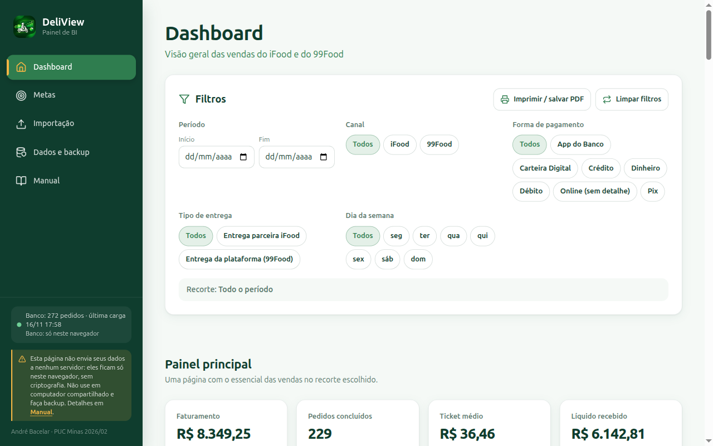
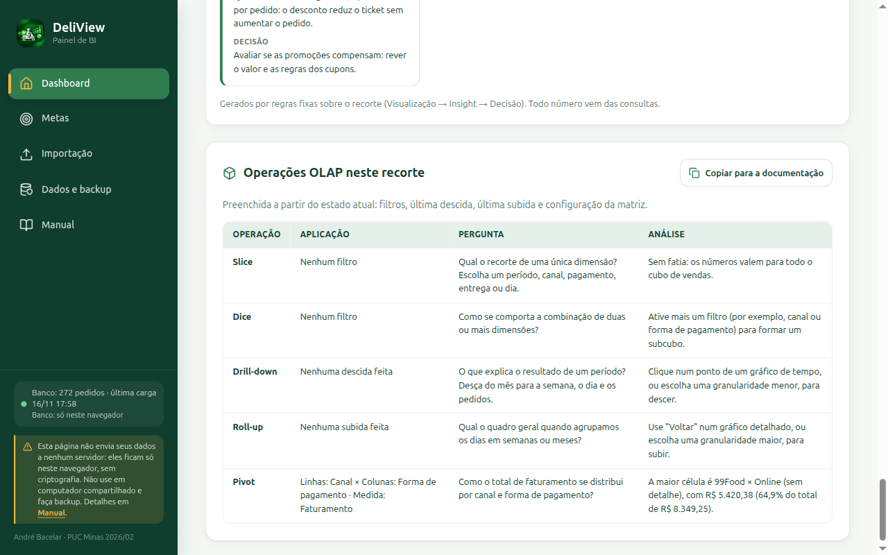
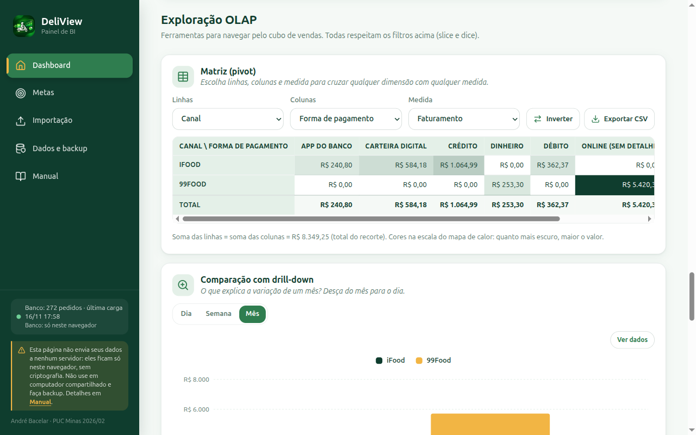

# Operações OLAP no DeliView

Este documento mostra as 5 operações OLAP (slice, dice, drill-down, roll-up e pivot) aplicadas ao cubo de vendas do portal, com as **duas planilhas fictícias de `exemplos/`** (setembro/2026) importadas. Nenhum número abaixo é de vendas reais. É o material da documentação OLAP da Etapa 7.

As tabelas abaixo não foram escritas à mão: foram geradas pelo botão **Copiar para a documentação** do bloco *Operações OLAP neste recorte*, no Dashboard, a partir do estado da tela em cada momento. O texto de cada análise é montado por regras (`BE.dash.operacoesOlap`, em `js/consultas/olap.js`) e todo número vem de consultas SQL ao banco.

## O cubo

| Elemento | No modelo |
|---|---|
| Fato | `FATO_PEDIDO` (grão = 1 pedido) |
| Dimensões | `DIM_TEMPO` (dia, semana, mês, dia da semana), `DIM_CANAL`, `DIM_PAGAMENTO`, `DIM_TIPO_ENTREGA`, `DIM_STATUS` |
| Medidas | Faturamento (`VALOR_TOTAL_PAGO` dos concluídos), pedidos concluídos, ticket médio, líquido, descontos, taxas, cancelados, taxa de cancelamento |

## Onde cada operação acontece no portal

| Operação | Como aplicar no Dashboard |
|---|---|
| Slice | Um único filtro na barra de filtros (ex.: só o período, ou só o canal) |
| Dice | Dois ou mais filtros combinados (ex.: período + canal) |
| Drill-down | Clicar num ponto ou barra de um gráfico de tempo (Mês → Semana → Dia → pedidos), ou escolher uma granularidade menor |
| Roll-up | "Voltar para…" num gráfico detalhado, ou escolher uma granularidade maior |
| Pivot | Matriz: escolher linhas, colunas e medida; "Inverter" troca os eixos |

## Exemplo 1: slice por período (abertura do Dashboard)

Recorte padrão: o último mês com dados, sem outros filtros. O período é o único filtro, então ele é o slice.

**Recorte: setembro/2026**

| Operação | Aplicação | Pergunta | Análise |
|---|---|---|---|
| Slice | Período = setembro/2026 | Como foram as vendas em setembro/2026 e qual canal puxou o resultado? | Em setembro/2026, o 99Food fez 72,1% dos pedidos concluídos (165 de 229); o faturamento foi de R$ 8.349,25, com ticket médio de R$ 36,46. |
| Dice | Nenhuma combinação (só período: setembro/2026) | Como se comporta a combinação de duas ou mais dimensões? | Ative mais um filtro (por exemplo, canal ou forma de pagamento) para formar um subcubo. |
| Drill-down | Nenhuma descida feita | O que explica o resultado de um período? Desça do mês para a semana, o dia e os pedidos. | Clique num ponto de um gráfico de tempo, ou escolha uma granularidade menor, para descer. |
| Roll-up | Nenhuma subida feita | Qual o quadro geral quando agrupamos os dias em semanas ou meses? | Use "Voltar" num gráfico detalhado, ou escolha uma granularidade maior, para subir. |
| Pivot | Linhas: Canal × Colunas: Forma de pagamento · Medida: Faturamento | Como o total de faturamento se distribui por canal e forma de pagamento? | A maior célula é 99Food × Online (sem detalhe), com R$ 5.420,38 (64,9% do total de R$ 8.349,25). |

A mesma tabela na tela:

## Exemplo 2: slice por canal

Datas apagadas e só o chip **99Food** marcado (`#/dashboard?canal=99Food`). A base de comparação é o cubo sem esse filtro.

**Recorte: Todo o período · 99Food**

| Operação | Aplicação | Pergunta | Análise |
|---|---|---|---|
| Slice | Canal = 99Food | Qual o peso de 99Food nas vendas? | Em todo o período, 99Food teve 165 pedidos concluídos (72,1% dos 229), faturamento de R$ 5.673,68 (68,0%) e cancelamento de 14,1%. |

## Exemplo 3: dice, drill-down, roll-up e pivot

Passos feitos na tela, em ordem:

1. **Dice:** com setembro/2026 no período, marcar o chip **iFood** no filtro de canal.
2. **Drill-down:** no bloco *Comparação com drill-down*, clicar na barra de setembro (Mês → Semana) e depois na semana de maior faturamento (Semana → Dia, 01/09 a 06/09).
3. **Roll-up:** clicar em *Voltar para semana* (Dia → Semana).
4. **Pivot:** na matriz, colunas = *Dia da semana*, medida = *Pedidos concluídos* e clicar em **Inverter** (dia da semana nas linhas, canal nas colunas).

**Recorte: setembro/2026 · iFood**

| Operação | Aplicação | Pergunta | Análise |
|---|---|---|---|
| Slice | Nenhum filtro único (2 filtros ativos: veja Dice) | Qual o recorte de uma única dimensão? | O recorte atual combina filtros; a análise está na linha Dice. |
| Dice | Período: setembro/2026 · Canal: iFood | Como se comporta o subcubo setembro/2026 · iFood? | Neste subcubo: 64 pedidos concluídos (27,9% dos 229 de setembro/2026), faturamento de R$ 2.675,57 (32,0%), ticket médio de R$ 41,81 (geral: R$ 36,46) e cancelamento de 20,0%. |
| Drill-down | Semana → Dia (01/09 a 06/09/2026) | Quais dias explicam o faturamento de 01/09 a 06/09/2026? | De 01/09 a 06/09/2026, o dia de maior faturamento foi 04/09 (sex), com R$ 253,12 (29,4% dos R$ 861,26, em 6 dias). |
| Roll-up | Dia → Semana (setembro/2026) | Como fica o faturamento agrupado por semana? | Em setembro/2026, a semana de maior faturamento foi 01/09 a 06/09, com R$ 861,26 (32,2% dos R$ 2.675,57, em 5 semanas). |
| Pivot | Linhas: Dia da semana × Colunas: Canal · Medida: Pedidos concluídos (eixos invertidos) | Como o total de pedidos concluídos se distribui por dia da semana e canal? | A maior célula é sábado × iFood, com 14 pedidos concluídos (21,9% do total de 64 pedidos concluídos). |

Matriz pivot (canal × forma de pagamento, faturamento) e o bloco de comparação com drill-down, no recorte de todo o período:

## Conferência dos números

Valores das planilhas de exemplo de setembro/2026, conferidos no portal:

| Medida | iFood | 99Food | Total |
|---|---|---|---|
| Pedidos | 80 | 192 | 272 |
| Pedidos concluídos | 64 | 165 | 229 |
| Faturamento | R$ 2.675,57 | R$ 5.673,68 | R$ 8.349,25 |
| Ticket médio | R$ 41,81 | R$ 34,39 | R$ 36,46 |
| Líquido | R$ 1.875,75 | R$ 4.267,06 | R$ 6.142,81 |
| Taxa de cancelamento | 20,0% | 14,1% | 15,8% |

## Insights do mesmo recorte

O bloco *Insights* aplica regras fixas ao recorte (Visualização → Insight → Decisão):

